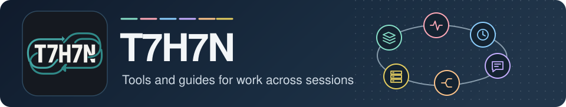
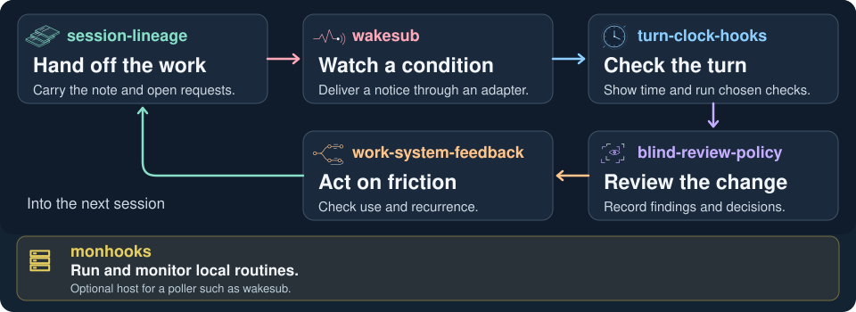

# 

Five standalone projects help people hand off unfinished work, deliver a notice to an idle session, check active turns, review changes, and repair shared ways of working.

## How the five pieces fit together

<picture>
  <source media="(max-width: 600px)" srcset="https://raw.githubusercontent.com/T7H7N/.github/main/profile/assets/loop-compact.svg">
  
</picture>

This is one way to use the projects together. The operator opens the next session, chooses which hooks to enable, and decides which findings or repairs to act on.

## Repositories

| Repository | Runtime or format | Start here when you need to... |
|---|---|---|
| [session-lineage](https://github.com/T7H7N/session-lineage) | Python 3.10+ and Git for handoff | Pass a project to a successor with its notes and open requests intact. |
| [wakesub](https://github.com/T7H7N/wakesub) | Python 3.9+, standard library | Send a notice when a file, time, or previous wake meets a condition. |
| [turn-clock-hooks](https://github.com/T7H7N/turn-clock-hooks) | Python 3.9+, standard library | Put the clock in a turn and choose individual command and file checks. |
| [blind-review-policy](https://github.com/T7H7N/blind-review-policy) | Markdown policy and templates | Review a fixed revision and decide what to do with each finding. |
| [work-system-feedback](https://github.com/T7H7N/work-system-feedback) | Markdown guide and templates | Turn a verified result into a weekly note or investigate recurring friction. |

## Component details

**Hand off a project.** In session-lineage, the project folder holds a working note, a journal for each owner's tenure, and an inbox. The outgoing owner leaves the next action and its pass condition in the journal. The operator commits the handoff and opens a fresh conversation. The successor reads the pack before taking the seat with `tools/seat_min.py`.

**Wait outside the session.** With wakesub, `--file` watches for a regular file to be present and `--file-nonempty` also requires content. Use `--at` for a time, or `--after` for an earlier subscription that reaches `fired`. A separate poller must run. The chosen adapter passes a notice to a local command or writes it to an inbox folder. Whether that notice wakes a session depends on the receiving integration. The bundled session-hook example is unverified on Windows desktop.

**Check an active turn.** Turn clock supplies local time and UTC on each user prompt, with the next seven local dates and weekdays. On hosts that support the tool-batch event, it refreshes the time after a batch. Five optional checks run independently. Shell dialect, Inline path, and Read window run before tool use. Script BOM checks writes and edits. Markdown lines checks writes.

**Review a change.** When blind review is called for, a fresh session from a different model family than the author's examines a fixed candidate against its requirements and evidence. The policy describes change grades and limits on rounds. The maintainer records a decision for each finding.

**Feed experience back into the system.** In work-system-feedback, a fragment carries a result and its evidence into a weekly report. A session note captures friction in the worker's own words. In a sweep, the owner counts independent observations, decides whether a shared rule, tool, or procedure needs repair, and checks use and recurrence in a later window.

## Design principles

- **Keep the evidence inspectable.** Working notes, inbox messages, subscription records, and review decisions can be inspected where the work happens.
- **Keep setup small.** The hooks and subscription poller use the Python standard library. Full session handoffs also use Git. The two guides can be used as plain Markdown.
- **Adopt one piece at a time.** A team can use the review policy on its own, start with a single clock hook, or carry a repair from a sweep into the next handoff.

[Browse all T7H7N repositories](https://github.com/orgs/T7H7N/repositories)

## Feedback

Each repository has a Discussions tab for notes from people who tried it. For anything that spans the projects, use [organization discussions](https://github.com/T7H7N/.github/discussions).
